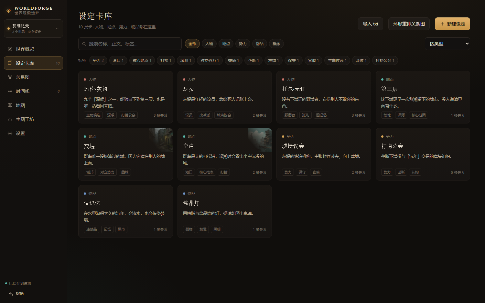
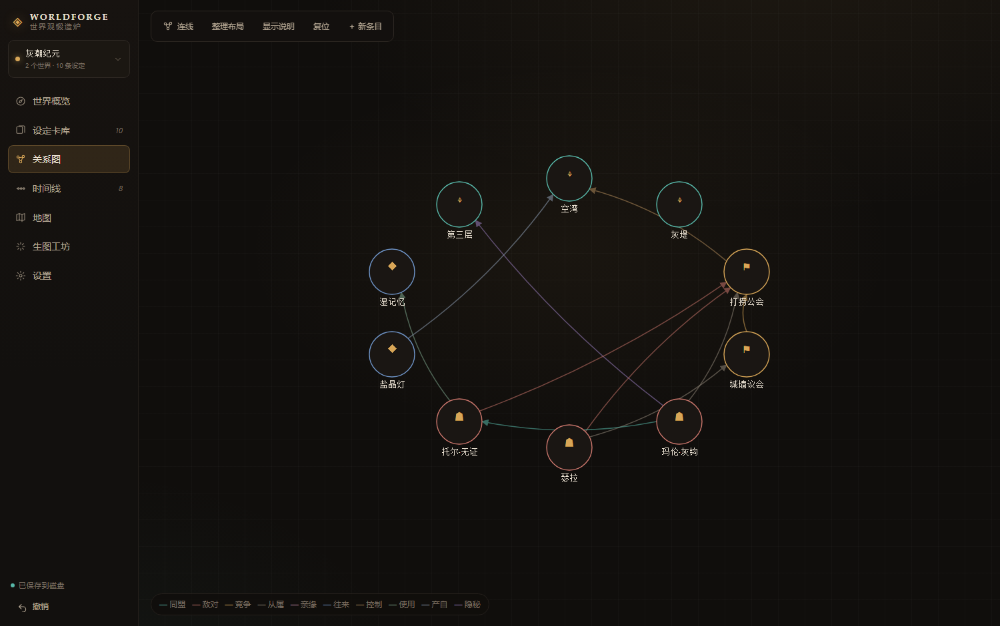
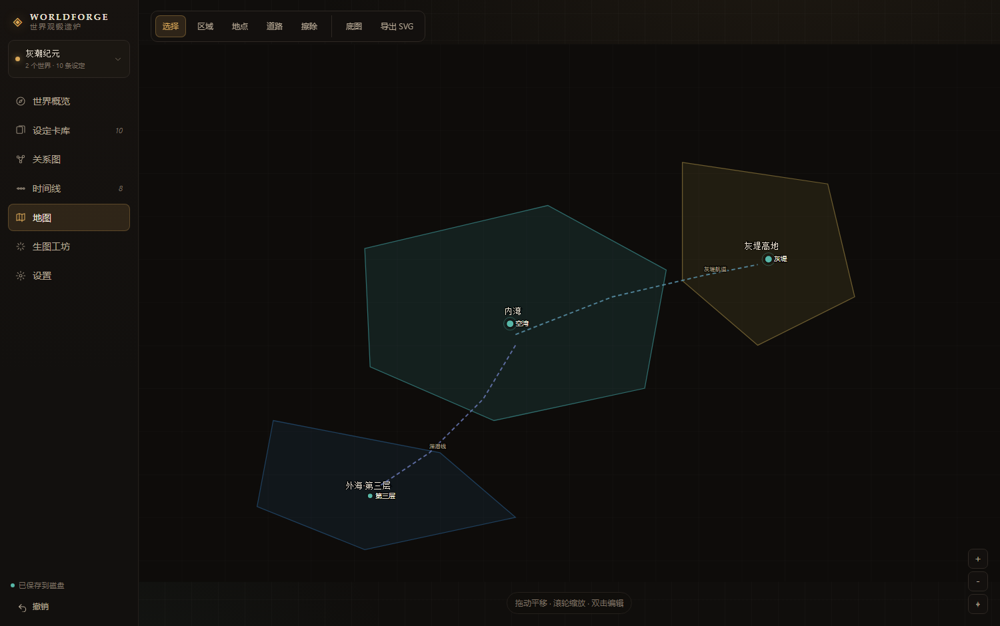
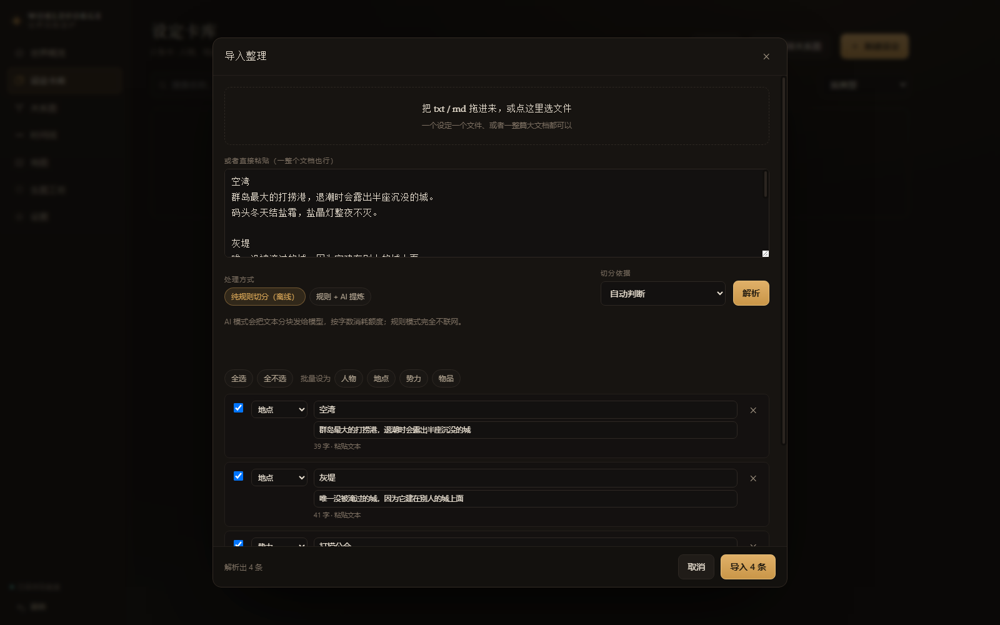
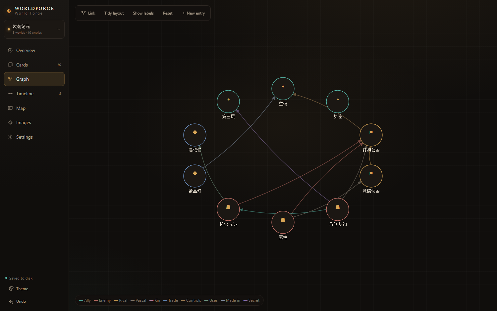
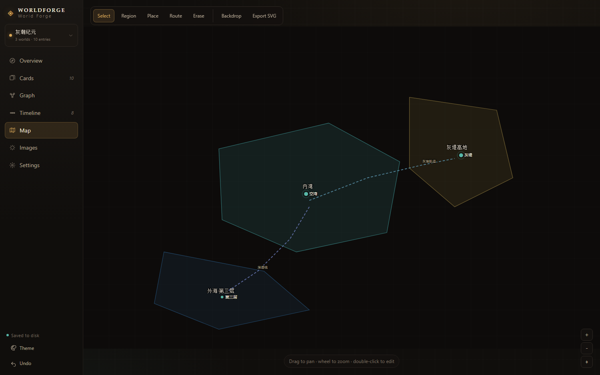
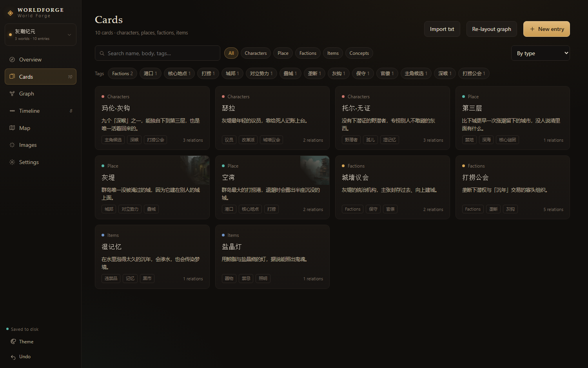
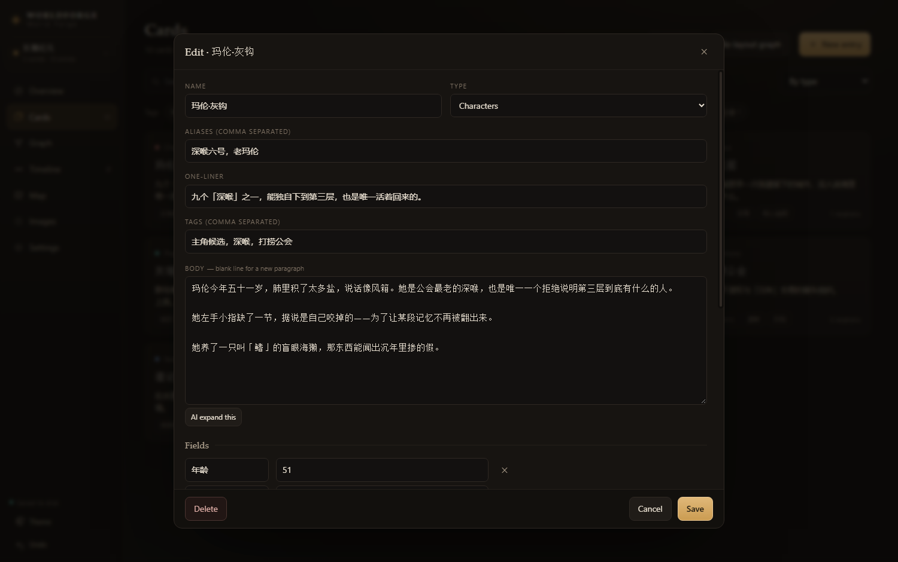

<div align="center">

# WorldForge · 世界观锻造炉

**跑在自己电脑上的世界观工作台：设定卡、关系图、时间线、程序化地图、生图工坊。**
**A local-first worldbuilding workbench: cards, graph, timeline, programmatic maps, image generation.**

<sub>纯本地 · 零依赖 · 零构建 · 数据是可备份的纯文本 —— Local files, no cloud, no build step.</sub>

[中文](#中文) · [English](#english)

</div>



---

## 中文

### 它解决什么

写世界观最容易烂在三个地方：设定散在十几个 txt 里对不上；关系只存在脑子里；地图只能靠脑补。WorldForge 把这三件事并到一个界面里，而且**数据就是磁盘上的 JSON** —— 想拿走、想 git、想手工改，都随你。

### 功能

| 模块 | 能做什么 |
|---|---|
| **设定卡库** | 五类卡（人物 / 地点 / 势力 / 物品 / 概念）；结构化字段、正文、别名、标签；**模糊搜索**：分词、子序列、错字容错、**拼音全拼与首字母**（`kongwan` / `kw`）；类型 + 标签筛选 |
| **关系图** | 拖节点排版，拖一条线就建关系；一键力导向整理；选中高亮邻居 |
| **时间线** | 按「线索」分泳道，事件卡**直接拖动改年份**，重叠事件自动错行 |
| **地图** | 区域多边形、地点图钉、航道浅线全部由程序绘制，可拖顶点、可缩放、可导出 SVG；生图只当底图皮肤 |
| **导入整理** | 把旧 txt / md 拖进来，按标题或空行切成候选卡，逐条勾选入库；可选 AI 提炼 |
| **生图工坊** | 按条目自动组织提示词 → 本地 ComfyUI 或智谱 → 一键挂回设定卡或设为地图底图 |
| **世界目录** | 多个世界观独立存放，左上角一键切换；新建 / 重命名 / 复制当前 / 删除 |
| **四套配色 + 中英双语** | 暗·琥珀 / 暗·青瓷 / 亮·羊皮纸 / 亮·雪；界面中英文一键切换，外加自选强调色 |

#### 关系图



#### 地图



地图是这套工具里最想强调的一点：**地理关系由程序绘制，不交给生成模型**。区域、城市、航道都是 SVG 图元，中文地名绝不会被画成鬼画符；生成模型只负责最底下那层纸张质感。

### 快速开始

需要 **Node.js 18+**（只用内置模块，不需要 `npm install`）。

```bat
:: Windows
双击 start.bat
```

```bash
# macOS / Linux
node server.mjs
```

打开 <http://127.0.0.1:7317>。

首次启动自带一个示例世界「灰潮纪元」（10 张卡、一张地图、3 张 AI 配图），看完随手删掉就行。

桌面上有个快捷方式叫**「创世之书」**，指向 `start.bat`，图标是自绘的 `assets/worldforge.ico`。

### 生图怎么接

**本地 ComfyUI（推荐，不花钱、不出网）**：设置 → 生图通道 → 选「本地 ComfyUI」，地址默认 `http://127.0.0.1:8188`，会自动读取 `models/checkpoints` 下的模型。尺寸按 64 取整：1:1 `1024²`、3:2 `1344×896`、2:3 `896×1344`、16:9 `1344×768`。

**智谱（云端）**：模型 `glm-image`，Base URL `https://open.bigmodel.cn/api/paas/v4`，Key 填在设置里或设环境变量 `ZHIPUAI_API_KEY`。

**AI 文本辅助（可选）**：「AI 扩写」「审稿」「导入时分类 / 推断关系」走任何 OpenAI 兼容接口（默认 DeepSeek）。**不填 Key 就完全不会发起请求**，规则切分、写卡、画图都不受影响。

### 把旧 txt 搬进来

设定卡库 → **导入 txt**（世界概览也有入口）。

- **一个设定一个文件**：文件名当卡名，正文首行重复会自动去掉
- **一整篇大文档**：优先按 `#` 标题；其次按「独立成行的短标题」；再不行按空行分段
- `名称：xxx`、`所属国家：xxx` 这类行会自动变成**结构化字段**，不会混进正文
- 逐条项目符号（`· 功能：…`）不会被误判成标题
- 切完先出预览：改类型、改名字、删掉不要的，再一键入库；新卡在关系图上自动排开

> 规则切分免费、离线，但只认结构不认语义。一段深度设定（比如一个城市的完整描述）大概率切得偏细，这时可以切到「规则 + AI 提炼」。



### 多个世界观

左上角带琥珀色圆点的按钮就是世界目录。每个世界独立一个 JSON，互不影响；`复制当前` 会连地图、时间线一起复制，适合做「同一设定的另一条世界线」。

### 配色与语言

四套预设（暗·琥珀 / 暗·青瓷 / 亮·羊皮纸 / 亮·雪），左下角按钮一键循环；设置 → 外观里还能自选强调色。界面语言在**设置 → 外观 → 界面语言**切换中文 / English，选择存在浏览器本地。

### 数据与备份

```
worldforge/
├─ data/
│  ├─ worlds/         ← 每个世界观一个 JSON
│  ├─ state.json      ← 当前打开哪个
│  ├─ config.json     ← 通道地址与密钥（只在本机）
│  └─ images/         ← 生成图
├─ public/            ← 前端，原生 ESM，无构建
├─ server.mjs         ← 后端，只用 Node 内置模块
├─ tools/             ← 开发用的探针 / 截图 / 打包脚本
└─ start.bat
```

改动后 0.6 秒自动写盘，左下角有状态点。备份 = 拷走整个 `data/`。「设置 → 数据」还能导出 JSON / Markdown 设定集。

### 快捷键

| 按键 | 作用 |
|---|---|
| `Ctrl/⌘ + Z` | 撤销（保留 40 步） |
| `Ctrl/⌘ + Shift + Z` / `Ctrl + Y` | 重做 |
| `Ctrl/⌘ + S` | 立即保存 |
| `Ctrl/⌘ + Enter` | 编辑弹窗里保存 |
| `Esc` | 关闭弹窗 / 取消正在画的区域 |

### 已知限制

- **单机单人**：没有并发控制，别同时开两个标签页编辑同一个世界
- 图片目录全局共享（图库记录仍按世界分开）
- 地图区域是简化多边形，不支持岛屿挖洞、曲线细分
- 拼音表覆盖 3755 个常用字，生僻字和多音字可能不准
- 主要在 Windows + Edge 上验证过

### 路线图

- [ ] 正文里 `[[空湾]]` 双链跳转 + 反链面板
- [ ] 每日自动快照备份
- [ ] 条目版本历史 / 差异对比
- [ ] 地图导出 PNG、关系图导出图片
- [ ] 移动端（只读 + 快速记录）
- [ ] 打包成 DeepSeek Harness 插件

### License

[MIT](LICENSE)

---

## English

### What it solves

Worldbuilding usually rots in three places: settings scattered across a dozen txt files, relationships that only live in your head, and maps you have to imagine. WorldForge puts all three in one window — and **your data is just JSON on disk**: portable, git-able, hand-editable.

### Features

| Module | What it does |
|---|---|
| **Cards** | Five types (character / place / faction / item / concept); structured fields, body, aliases, tags; **fuzzy search** with tokenising, subsequence matching, typo tolerance and **pinyin** (`kongwan`, `kw`); filter by type and tag |
| **Graph** | Drag nodes to lay out, drag a line to create a relation; one-click force layout; neighbours highlight on select |
| **Timeline** | Lanes per story thread; **drag a card to change its year**; overlapping events stack automatically |
| **Map** | Regions, pins and routes are **drawn programmatically** — draggable vertices, zoom, SVG export. Image generation only supplies the paper texture underneath |
| **Import** | Drop old txt / md files; they are split into candidate cards by headings or blank lines, with an optional AI pass |
| **Image studio** | Builds prompts from an entry → local ComfyUI or Zhipu → attach to the card or use as map backdrop |
| **World directory** | Multiple worlds, each in its own JSON; switch from the top-left menu; create / rename / duplicate / delete |
| **4 themes + i18n** | Amber / Ink / Paper / Snow, plus a custom accent; UI in Chinese or English |

#### Graph



#### Map



The part worth emphasising: **geography is drawn by code, not by an image model.** Regions, cities and sea lanes are SVG primitives — place names are always spelled correctly. The model only paints the paper underneath.

#### English UI





### Quick start

Requires **Node.js 18+**. No dependencies, no `npm install`.

```bat
:: Windows
start.bat
```

```bash
# macOS / Linux
node server.mjs
```

Then open <http://127.0.0.1:7317>.

A sample world ("Grey Tide") ships on first run — 10 cards, a map, 3 generated images. Delete it whenever.

### Image generation

**Local ComfyUI (recommended, free and offline)** — Settings → Image providers → Local ComfyUI, default `http://127.0.0.1:8188`. Checkpoints under `models/checkpoints` are listed automatically. Sizes snap to multiples of 64: `1024²`, `1344×896`, `896×1344`, `1344×768`.

**Zhipu (cloud)** — model `glm-image`, base URL `https://open.bigmodel.cn/api/paas/v4`; put the key in Settings or set `ZHIPUAI_API_KEY`.

**AI text helpers (optional)** — expand / critique / classify work with any OpenAI-compatible endpoint (DeepSeek by default). **Without a key nothing is ever sent**; rule-based splitting, cards and maps keep working.

### Importing your old txt

Cards → **Import txt**.

- **One entry per file**: filename becomes the card name
- **One big document**: split by `#` headings first, then by standalone short title lines, then by blank lines
- `Name: xxx` style lines become **structured fields** instead of body text
- Bullet lines (`· Function: …`) are not mistaken for headings
- Preview before importing: change types, rename, drop rows, then import in one go

> Rule-based splitting is free and offline, but it only understands structure, not meaning. A deep single-city document tends to be split too finely — that's when the optional AI pass earns its keep.


### Data & backup

```
worldforge/
├─ data/
│  ├─ worlds/      ← one JSON per world
│  ├─ state.json   ← which world is open
│  ├─ config.json  ← provider URLs and keys (local only)
│  └─ images/      ← generated images
├─ public/         ← frontend, native ESM, no build
├─ server.mjs      ← backend, Node built-ins only
└─ tools/          ← probe / screenshot / release scripts
```

Writes land 0.6 s after you stop typing. Backing up `data/` backs up everything.

### Keyboard

`Ctrl/⌘+Z` undo · `Ctrl/⌘+Shift+Z` redo · `Ctrl/⌘+S` save · `Ctrl/⌘+Enter` save in a dialog · `Esc` close / cancel.

### Known limits

- **Single user, single machine** — no concurrency control; don't edit one world from two tabs
- Images are shared across worlds (gallery records are per world)
- Map regions are simple polygons — no islands with holes, no bezier smoothing
- The pinyin table covers 3,755 common characters; rare characters and polyphones may be off
- Mainly tested on Windows + Edge

### Roadmap

- [ ] `[[wikilinks]]` in body text + backlinks panel
- [ ] Daily automatic snapshots
- [ ] Per-entry version history / diffs
- [ ] Map PNG export, graph image export
- [ ] Mobile view (read + quick capture)
- [ ] Package as a DeepSeek Harness plugin

### License

[MIT](LICENSE)

---

<sub>做这个东西的初衷很简单：不想再把世界观塞进二十个 txt 里。 — Built because worldbuilding shouldn't live in twenty text files.</sub>
